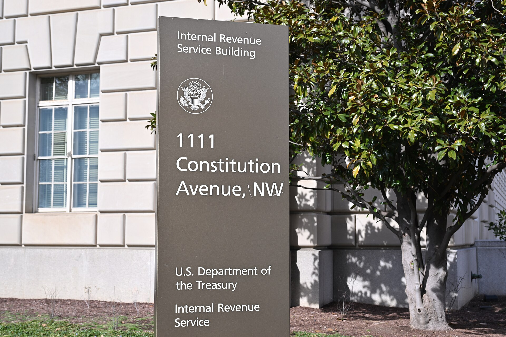

2027 brings two tax moments at once. In spring you file your **2026 return**, the first full year under the 2025 tax law's new deductions. And from January 1 the **2027 tax year** starts with new, inflation-adjusted brackets that the IRS published on November 5, 2026 (Revenue Procedure 2026-35).

This guide covers both, in plain language, with a checklist at the end.

## The 2027 numbers at a glance

| Item | Tax year 2026 | Tax year 2027 |
|---|---|---|
| Standard deduction, single | $16,100 | **$16,600** |
| Standard deduction, married filing jointly | $32,200 | **$33,200** |
| Standard deduction, head of household | — | **$24,925** |
| Child tax credit (per child) | $2,200 | **$2,300** |
| Refundable part of the child tax credit | $1,700 | **$1,800** |
| Tax rates | 10% to 37% | **unchanged** |

Bracket thresholds rise about **3.2%**, so the same salary falls a little lower in the table. If your raise is smaller than that, your federal income tax can actually go down.

> 💡 **Tip** These 2027 figures apply to the return you file in **2028**. For the return you file in April 2027, use the 2026 column.

## Deductions that stay the same in dollars

Some newer breaks are written as fixed amounts, so they do **not** grow with inflation in 2027:

- **Senior deduction:** an extra **$6,000** per person aged 65 or older (on top of the regular extra standard deduction), phased out at higher incomes. It runs through 2028.
- **No tax on tips:** a deduction of up to **$25,000** of qualified tips for eligible workers.
- **Overtime deduction:** a deduction for the extra "half" of time-and-a-half pay, up to **$12,500** (or $25,000 for joint filers).

All three are deductions, not exemptions. You still pay Social Security and Medicare tax on tips and overtime, and you have to claim them on your return.

*Photo: G. Edward Johnson / Wikimedia Commons, CC BY 4.0*

## The 2027 filing season: what to expect

The return you file in early 2027 covers 2026. Expect three things:

1. **New lines and schedules** for the tips, overtime and senior deductions. Check your W-2 and pay stubs for the amounts of tips and overtime you received.
2. **A possible refund** if your paycheck withholding did not account for these new deductions.
3. **The usual deadline,** April 15, 2027, unless the IRS grants an extension for your area (for example after a disaster).

> ⚠️ **Watch out** Keep your own pay stubs and tip records. If the amounts are not shown separately on your W-2, you need them to back up the deduction.

## What to do before December 31

1. **Check your withholding** with the IRS Tax Withholding Estimator. If you got a large refund, a new W-4 puts that money in your paycheck instead.
2. **Max out pre-tax accounts** (401(k), HSA, traditional IRA) to lower 2026 taxable income. The IRS announces the 2027 contribution limits separately.
3. **Bunch charitable gifts** if you are close to itemizing, or give from an IRA if you are 70½ or older.
4. **Save records** for tips, overtime and any home office or education expenses now, not in March.

## Quick answers

### Do I get the new standard deduction on my 2027 paycheck?

Indirectly, yes. Payroll withholding tables for 2027 are updated in January, so your take-home pay changes slightly from the first paycheck of the year.

### Is anything still waiting on Congress?

The numbers above are already official. Congress can always pass new tax laws, but nothing announced so far changes the 2027 inflation adjustments.

---

**Sources:** IRS news release on the tax year 2027 inflation adjustments and Revenue Procedure 2026-35 (Nov. 5, 2026); KPMG and Journal of Accountancy summaries. This article is general information, not tax advice for your situation.
