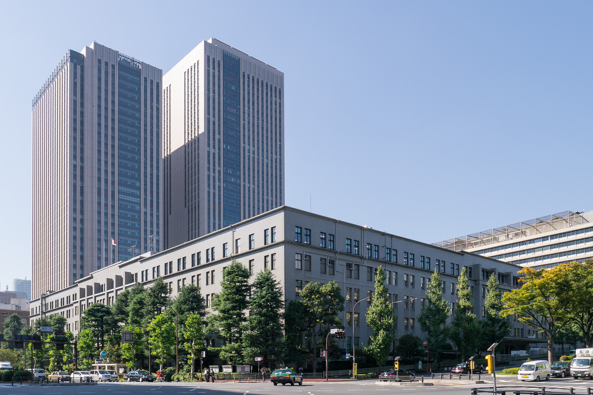

2027年（令和9年）は、**所得税の「年収の壁」引き上げが続く一方で、住民税は据え置き**という、少しややこしい年になります。この記事では令和8年度税制改正のうち、**2027年の給与・確定申告・住民税に関わるもの**だけを、生活者目線でまとめました。

> ⚠️ **注意** 2026年11月26日時点の情報です。例年12月に翌年度の税制改正大綱が公表されるため、内容が追加・変更される可能性があります。

## 2027年に関わる主な変更

| 項目 | 2027年の扱い |
|---|---|
| 所得税の基礎控除 | 合計所得に応じて **最大104万円**（2026・2027年分の特例） |
| 給与所得控除の最低保障額 | **74万円**（2026・2027年分の特例を含む） |
| 住民税の基礎控除 | **43万円のまま**（引き上げなし） |
| ひとり親控除（所得税） | 35万円 → **38万円** |
| ふるさと納税 | 2027年の寄付から住民税の特例控除に **193万円の上限** |
| こどもNISA | **18歳未満**も対象に（**2027年1月開始**、年60万円・総額600万円まで） |

## 所得税の「年収の壁」は2027年も特例が続く

所得税の基礎控除は、合計所得が低い人ほど手厚くなる仕組みです。2026年分と2027年分は特例で上乗せされ、中低所得層では**最大104万円**になります。給与所得控除の最低保障額（74万円）と合わせると、**年収178万円程度までは所得税がかからない**計算です。

ただし、この上乗せは**2027年分までの時限措置**です。2028年以降どうなるかは、これからの税制改正で決まります。

> 💡 **ポイント** パート・アルバイトで働く家族がいる場合、扶養親族の所得要件も **58万円以下 → 62万円以下** に緩和されています。年末調整の書類を書くときに確認しましょう。

## 住民税は据え置き — 「所得税ゼロでも住民税はかかる」に注意

住民税の基礎控除は**43万円のまま**です。そのため、所得税がかからない年収でも、住民税はかかるケースが増えます。

住民税は前年の所得に対して6月から課税されるので、**2026年の収入にかかる住民税は2027年6月から**の給与天引き・納付書で届きます。「所得税が戻ってきたのに住民税が来た」と驚かないよう、手取り計画に入れておきましょう。

*写真: Rs1421 / Wikimedia Commons, CC BY-SA 3.0*

## ふるさと納税：高所得者に上限ができる

2027年の寄付から、住民税から差し引かれる特例控除額に**193万円の上限**が設けられます。影響を受けるのは年収がかなり高い一部の人で、一般の会社員の寄付額にはほぼ影響ありません。

なお、2025年10月からはポータルサイトのポイント付与が禁止されています。「どこで寄付しても返礼品は同じ」なので、**使い慣れたサイトで、控除上限内に収める**のが基本です。

## ひとり親控除とこどもNISA

- **ひとり親控除**：所得税の控除額が **35万円から38万円**に、住民税は **30万円から33万円**に増えます。適用開始の年は所得税と住民税で異なるので、勤務先や自治体の案内で確認しましょう。
- **こどもNISA**：税制改正法の成立により、**2027年1月から**18歳未満も使えるNISAが始まります。非課税で投資できるのは**年60万円、総額600万円**までです。
- **暗号資産**：雑所得（総合課税）から税率20.315%の申告分離課税へ移す方針ですが、対象は「特定暗号資産」に限られ、**開始時期は資料によって2027年・2028年と分かれています**。確定情報は金融庁・財務省の発表で確認してください。

## 年末までのチェックリスト

1. **家族の年収を確認**：扶養に入れるか、配偶者控除の対象かを62万円基準で見直す。
2. **住民税の予算化**：2027年6月からの住民税額を、2026年の年収からざっくり計算しておく。
3. **ふるさと納税は12月31日まで**：2026年分の控除枠を使い切る。
4. **iDeCo・NISAの枠確認**：年内の拠出・買付を済ませる。
5. **12月の税制改正大綱**：令和9年度改正の内容を確認する。

## よくある質問

### 2026年の年末調整から変わりますか？

はい。基礎控除の特例は2026年分から適用されるので、**2026年末の年末調整**から反映されます。2027年も同じ特例が続きます。

### 住民税の基礎控除はいつ上がりますか？

2026年11月時点で、住民税の基礎控除（43万円）を引き上げる改正は決まっていません。

---

**参考資料**：財務省「令和8年度税制改正の大綱」、総務省・各自治体の住民税案内、税理士法人・証券会社の解説記事。本記事は一般的な情報であり、個別の税務相談に代わるものではありません。
